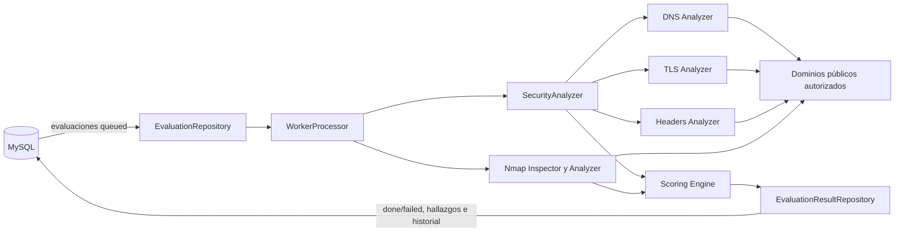

# CyberScore Worker

Worker asíncrono para procesar evaluaciones de seguridad de pequeñas y medianas empresas (PYMES). El proceso toma evaluaciones en cola desde MySQL, analiza dominios autorizados en DNS, TLS, HTTP y Nmap, calcula un CyberScore y guarda el resultado, los hallazgos y el historial de puntuaciones.

> **Estado del proyecto:** versión 1.0.0. Este componente funciona como proceso de backend y no expone una interfaz HTTP propia.

## Tabla de contenidos

- [Objetivo](#objetivo)
- [Características](#características)
- [Arquitectura técnica](#arquitectura-técnica)
- [Requisitos](#requisitos)
- [Instalación](#instalación)
- [Configuración](#configuración)
- [Uso](#uso)
- [Restricciones de uso y seguridad](#restricciones-de-uso-y-seguridad)
- [Estados de una evaluación](#estados-de-una-evaluación)
- [Pruebas](#pruebas)
- [Estructura del proyecto](#estructura-del-proyecto)
- [Operación y soporte](#operación-y-soporte)
- [Contribución](#contribución)
- [Licencia](#licencia)

## Objetivo

Automatizar la evaluación técnica y económica de la postura de seguridad de un dominio autorizado, de manera desacoplada del sistema que crea las evaluaciones. El worker permite:

1. Reclamar de forma transaccional una evaluación pendiente.
2. Ejecutar análisis DNS, TLS, HTTP y Nmap en paralelo.
3. Identificar y clasificar hallazgos de seguridad.
4. Calcular una puntuación de 0 a 100 y un nivel de riesgo.
5. Persistir el resultado de forma atómica en MySQL.

El score se calcula con la versión de fórmula `1.1` y la matriz de riesgo definida en el código. Las estimaciones económicas usan los ingresos, horas operativas y moneda registrados para la PYME. La versión 1.1 incorpora las penalizaciones de puertos Nmap del worker Python: 20 puntos por cada puerto abierto 21, 22, 23, 3306 o 3389; 10 por cada otro puerto abierto, excepto 80 y 443. Si Nmap no se ejecuta o falla, no se aplica esa penalización. Un puerto expuesto no se presenta como una vulnerabilidad confirmada.

## Características

- Procesamiento continuo por lotes y con intervalo configurable.
- Pool de conexiones MySQL y transacciones para reclamar y completar evaluaciones.
- Validación de dominios y bloqueo de direcciones IP privadas, reservadas o no públicas.
- Análisis de registros DNS, certificado/protocolo TLS y cabeceras de seguridad HTTP.
- Análisis Nmap de puertos y versiones de servicios en dominios expresamente autorizados.
- Evidencia limitada a datos relevantes; no se almacenan cabeceras potencialmente sensibles como cookies.
- Logging estructurado con Pino.
- Cierre ordenado ante `SIGINT` y `SIGTERM`.
- Pruebas automatizadas con Jest y TypeScript.

## Arquitectura técnica



### Componentes

- `src/index.ts`: composición de dependencias, ciclo de polling, señales y apagado.
- `src/config/env.ts`: carga y validación de variables de entorno.
- `src/database/pool.ts`: pool, prueba de conexión y cierre de MySQL.
- `src/jobs/`: reclamación de evaluaciones y persistencia de resultados.
- `src/security/`: validación del objetivo y análisis DNS, TLS y HTTP.
- `src/services/`: inspectores de red usados por los analizadores, incluido el ejecutor controlado de Nmap.
- `src/scoring/`: matriz, cálculo de riesgo, impacto económico y CyberScore.

### Flujo de datos

La tabla `evaluaciones` debe contener registros con estado `queued` y relacionarse con `pymes`. El worker cambia el registro a `running`, ejecuta el análisis y, si termina correctamente, lo cambia a `done`, guarda hallazgos en `hallazgos` y agrega una entrada en `historial_scores`. Ante un error de análisis, intenta marcarlo como `failed`.

## Requisitos

### Software

- Node.js 20 LTS o superior.
- npm 10 o superior.
- MySQL compatible con `mysql2` 3.x, con el esquema de CyberScore disponible.
- Nmap para ejecución local; la imagen Docker instala Nmap en la etapa de producción.
- Acceso de red saliente para resolver DNS y consultar por HTTPS los dominios autorizados.

El proyecto está desarrollado y compilado con:

- TypeScript `5.9.x`.
- Target `ES2022`.
- Módulos CommonJS.
- Jest `30.x` y `ts-jest` para pruebas.

### Dependencias de ejecución

- `dotenv`: configuración desde `.env`.
- `mysql2`: conexión y transacciones con MySQL.
- `pino`: logging estructurado.

Las versiones exactas y las integridades se controlan mediante `package-lock.json`.

### Lenguajes

- TypeScript como lenguaje principal.
- JavaScript CommonJS generado en `dist/`.
- SQL para consultas y persistencia en MySQL.
- JSON para resúmenes de capas, evidencias y configuración.

## Instalación

```bash
git clone https://github.com/DeviD0527/cyberscore-worker.git
cd cyberscore-worker
npm ci
```

Configure el esquema de base de datos de CyberScore antes de iniciar el worker. Use `.env.example` como plantilla:

```bash
copy .env.example .env
```

En Linux o macOS, el equivalente es:

```bash
cp .env.example .env
```

Después, complete las credenciales y los dominios permitidos en `.env`.

## Configuración

| Variable | Obligatoria | Valor predeterminado | Descripción |
|---|---:|---:|---|
| `NODE_ENV` | No | `development` | `development`, `test` o `production`. |
| `LOG_LEVEL` | No | `info` | `fatal`, `error`, `warn`, `info`, `debug`, `trace` o `silent`. |
| `DB_HOST` | Sí | — | Host de MySQL. |
| `DB_PORT` | No | `3308` | Puerto entero entre 1 y 65535. |
| `DB_NAME` | Sí | — | Base de datos del sistema. |
| `DB_USER` | Sí | — | Usuario de MySQL. |
| `DB_PASSWORD` | Sí | — | Contraseña de MySQL. |
| `WORKER_POLL_INTERVAL_MS` | No | `5000` | Espera cuando no hay evaluaciones, en milisegundos. |
| `WORKER_BATCH_SIZE` | No | `1` | Máximo de evaluaciones procesadas por ciclo. |
| `ALLOWED_DOMAINS` | No | — | Lista administrativa opcional de dominios. No reemplaza el activo autorizado en MySQL. |
| `ALLOW_ANY_PUBLIC_DOMAIN` | No | `false` | Compatibilidad con validación de red; el worker procesa evaluaciones solo si el activo coincide en MySQL y tiene autorización declarada. |
| `NMAP_SCAN_MODE` | No | `standard` | `standard` examina los 1000 puertos TCP principales; `deep` examina todos los puertos TCP. |
| `VIRUSTOTAL_API_KEY` | No | — | Clave API v3 opcional para consultar reputación, estadísticas y categorías del dominio. Sin clave válida, la capa se informa como no disponible. |

Ejemplo mínimo:

```dotenv
NODE_ENV=production
LOG_LEVEL=info
DB_HOST=localhost
DB_PORT=3308
DB_NAME=cyberscore_pyme
DB_USER=cyberscore_worker
DB_PASSWORD=coloque_un_secreto_seguro
WORKER_POLL_INTERVAL_MS=5000
WORKER_BATCH_SIZE=1
ALLOWED_DOMAINS=
ALLOW_ANY_PUBLIC_DOMAIN=false
NMAP_SCAN_MODE=standard
# VIRUSTOTAL_API_KEY=clave_api_v3
```

No agregue `.env` al control de versiones ni incluya credenciales reales en documentación, logs o commits.

## Uso

### Desarrollo

Ejecuta TypeScript directamente con `ts-node`:

```bash
npm run dev
```

### Producción

Compile y ejecute el JavaScript generado:

```bash
npm run build
npm start
```

El proceso permanece activo mientras consulta la cola. Para detenerlo, envíe `SIGINT` o `SIGTERM`; el worker cerrará el pool de MySQL antes de finalizar.

### Scripts disponibles

| Comando | Propósito |
|---|---|
| `npm run build` | Compilar `src/` en `dist/` con declaraciones y source maps. |
| `npm start` | Ejecutar `dist/index.js`. |
| `npm run dev` | Ejecutar `src/index.ts` con `ts-node`. |
| `npm test` | Ejecutar todas las pruebas una vez. |
| `npm run test:watch` | Ejecutar Jest en modo observación. |

## Restricciones de uso y seguridad

- Use el worker únicamente sobre dominios propios o con autorización explícita del propietario.
- El usuario debe declarar expresamente la autorización al registrar el dominio. Para esta entrega no se exige una prueba DNS TXT.
- El backend y el worker confirman en MySQL que el dominio de la evaluación es el activo autorizado de la misma PyME antes de procesarla.
- Nmap solo se ejecuta para ese activo registrado y autorizado; una entrada en `ALLOWED_DOMAINS` no concede autorización por sí sola.
- La validación de red permite únicamente destinos públicos; las redes privadas, loopback, link-local, multicast, reservadas y de documentación siguen bloqueadas.
- Solo se aceptan nombres de dominio válidos; no se permiten URL completas, rutas, puertos, credenciales embebidas ni espacios.
- El destino debe resolver a direcciones IP públicas. Se bloquean redes privadas, loopback, link-local, multicast, reservadas y de documentación.
- El worker no debe exponerse directamente a Internet ni ejecutarse con credenciales MySQL administrativas.
- Las credenciales y API keys deben entregarse mediante variables de entorno o un gestor de secretos.
- Un score alto significa que no se encontraron hallazgos dentro del alcance evaluado; no representa ausencia absoluta de vulnerabilidades.
- El análisis no sustituye una auditoría de seguridad, una prueba de penetración ni una revisión de cumplimiento.

## Estados de una evaluación

```text
queued -> running -> done
                 \-> failed
```

- `queued`: lista para ser reclamada.
- `running`: tomada por el worker y en proceso.
- `done`: análisis, score, hallazgos e historial guardados.
- `failed`: ocurrió un error durante el procesamiento.

## Pruebas

Ejecute:

```bash
npm test
```

Para comprobar también la compilación:

```bash
npm run build
```

Las pruebas usan Jest y cubren configuración, base de datos, validación de objetivos, inspectores, analizadores, cálculo de score y procesamiento del worker. Para las pruebas de integración se requiere una configuración de MySQL compatible y variables de entorno válidas.

## Estructura del proyecto

```text
src/
├── config/       # Configuración y validación del entorno
├── database/     # Pool y conexión MySQL
├── jobs/         # Cola, procesamiento y persistencia
├── scoring/      # Fórmula, matriz y nivel de riesgo
├── security/     # Validación y análisis de seguridad
├── services/     # Inspectores DNS/HTTP/TLS y ejecución de Nmap
└── index.ts      # Punto de entrada del worker
test/             # Pruebas automatizadas
.env.example      # Plantilla de configuración
```

## Operación y soporte

Para dar soporte sin depender del autor original:

1. Revise primero el nivel de log configurado y la salida estructurada de Pino.
2. Verifique que `DB_HOST`, `DB_PORT`, `DB_NAME`, `DB_USER` y `DB_PASSWORD` sean correctos.
3. Compruebe la conectividad a MySQL y que existan las tablas `evaluaciones`, `pymes`, `hallazgos` e `historial_scores`.
4. Confirme que las evaluaciones estén en `queued` y que sus datos económicos usen una moneda soportada: `COP`, `USD`, `EUR` o `MXN`.
5. Compruebe DNS, HTTPS/TLS y conectividad saliente hacia los dominios autorizados.
6. Si una evaluación falla, consulte el error registrado y verifique que haya pasado a `failed`.
7. Antes de cambiar la fórmula, la matriz o el esquema, ejecute `npm test` y `npm run build`.

Las decisiones metodológicas del score se documentan en `src/scoring/`, y las reglas de validación y seguridad de red en `src/security/`. Cualquier modificación debe conservar sus pruebas correspondientes.

## Contribución

1. Cree una rama para el cambio.
2. Mantenga los tipos estrictos y siga la estructura existente.
3. Agregue o actualice pruebas para el comportamiento modificado.
4. Ejecute `npm test` y `npm run build`.
5. Abra un pull request describiendo el cambio, su impacto y la configuración requerida.

No incluya secretos, archivos `.env`, `node_modules/`, `dist/` ni reportes de cobertura en los commits.

## Licencia

Este proyecto declara licencia `ISC` en `package.json`. Consulte ese archivo para los términos aplicables.

